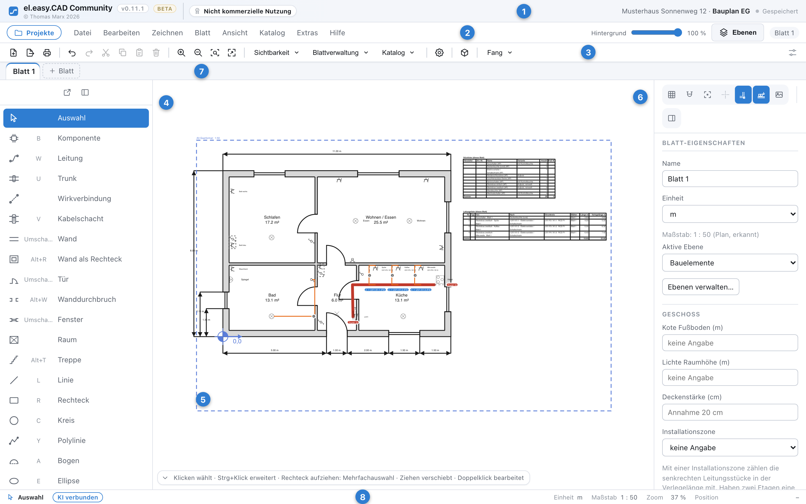
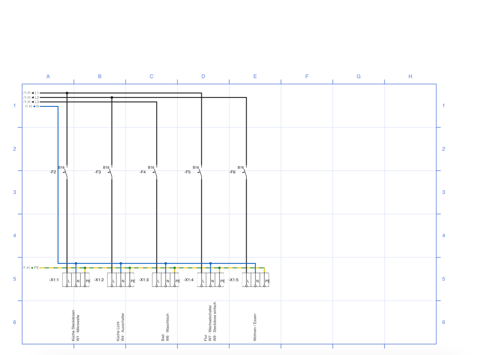
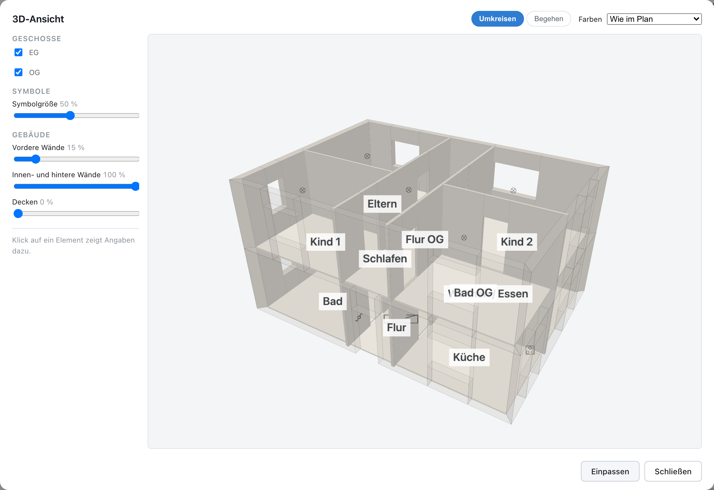

# el.easy.CAD Community

I'm still working on this page and also the app – it’ll be improved bit by bit. I’ll be adding more information soon. Feel free to test this app. Please read the manual in the program. There are still some issues with workflows and usability. The development is still in progress.

Ich arbeite an dieser Seite und werde sie sowie das Programm stetig verbessern. Weitere Informationen werden bald nachgepflegt. Bitte lest Euch die Online-Bedienungsanleitung durch. Noch gibt es einige Verbesserungen in der Bedienbarkeit und den Workflows. Die Entwicklung ist noch im Gange. Es handelt sich um eine Entwicklungsversion.
*Deutsche Fassung weiter unten.*

el.easy.CAD is a desktop planning tool for electrical, KNX channel and network installation planning. Load a floor
plan (PDF, DXF, IFC or image) as background, calibrate it, place components from a product
catalogue, route cables automatically, bundle them in trunks and cable risers across storeys, and
print or export every sheet as PDF, Excel or IFC. It also draws schematics and distribution board
diagrams.

The application runs entirely on your computer (PC and macOS): a small local server stores projects in a SQLite
file, and el.easy.CAD itself sends nothing anywhere. An optional AI assistant can read and edit
your drawings – see [Working with an AI assistant](#working-with-an-ai-assistant-mcp).

> The user interface and the built-in manual are available in German and English.

## Screenshots


*Floor plan with components, automatically routed cables, a trunk and parts lists on the sheet
(German user interface; English is available too).*

| Distribution board plan | 3D view |
|---|---|
|  |  |

## Working with an AI assistant (MCP)

el.easy.CAD has a built-in interface for AI assistants such as **Claude** (Claude Code or Claude
Desktop), based on the [Model Context Protocol](https://modelcontextprotocol.io). Ask about the
open drawing in plain language – or let the assistant do the drawing work for you.

- **Ask:** “Which cables have a free end?”, “How many socket outlets are on the upper floor?”,
  “Show me the distribution tree of +UV1”, “Are any terminal numbers assigned twice?” The
  assistant reads sheets and objects, rooms, the catalogue, every list (parts list, cable list
  with lengths, circuit directory and more), the distribution tree, a check for anomalies and
  screenshots of the sheets.
- **Edit:** set properties on many objects at once (label, height, mounting location, surface or
  flush mounting, circuit, KNX, variable texts, cable type …), delete, move and rotate objects,
  swap components for another catalogue entry, add sheets.
- **Draw floor plans:** place components from the catalogue – at a point, in the middle of a room
  or on a wall at a given distance and height, lined up like by hand –, route cables
  automatically (also through trunks to a free switch port or into the distribution board, with
  connection to a terminal), create trunks, walls, rooms, doors and windows.
- **Draw schematics:** place devices in a grid field (“C3”), set potentials and draw connections
  from terminal to terminal (“A1” → “13”), single-line, multi-pole or multi-line, with branches –
  and arrange the devices automatically.
- **Plan distribution boards:** propose the equipment from the rooms, edit the distribution tree,
  assign KNX actuators, renumber a terminal strip and generate the distribution board diagram.

Device tags, terminal and cable numbers are assigned exactly as if you had drawn by hand.

**You stay in control.** The interface is off by default. Once switched on, it only answers on
this computer and only to requests with its access token; *AI may only read* forbids every
change. Each change by the assistant is a single undo step starting with “AI:” and is listed in
the AI log, and while you are working with a drawing tool it changes nothing. You bring the
language model with your own account: whatever the assistant reads – including room names and
screenshots – goes to its provider, for Claude to Anthropic.

**Setting up:** *Extras › Program settings… › AI assistant*, agree to the note on data sharing,
then run the displayed `claude mcp add …` command once (Claude Code) or copy the displayed block
into `claude_desktop_config.json` (Claude Desktop). The manual in the app describes everything
in the chapter *Working with an AI assistant*.

As with every result of the program: check what the assistant does before you rely on it.

## Licence

el.easy.CAD Community is licensed under the
[PolyForm Noncommercial License 1.0.0](LICENSE):

- **Free for any non-commercial use** – private persons, non-profit organisations, schools and
  public institutions as defined by the licence. All features, no time limit. Printouts and
  exports carry the note “Non-commercial use”.
- **Commercial or professional use is not permitted** under this licence.

The licence text in [LICENSE](LICENSE) is binding. Third-party libraries and their licences are
listed in [LICENSES.md](LICENSES.md) and in the app under *Hilfe › Lizenzen der
Fremdbibliotheken*.

## Disclaimer

el.easy.CAD Community is a planning aid and comes without any warranty. Have every planning
result checked by a qualified electrician before you use it. Responsibility for the planning and
for compliance with the recognised rules of technology remains with the
user.

## Download

Ready-made apps for macOS (Apple Silicon) and Windows are published under *Releases*. They are
**not signed** with a commercial certificate:

- **macOS:** right-click the app › *Open*, then confirm. Alternatively *System Settings › Privacy &
  Security › Open Anyway*.
- **Windows:** in the SmartScreen dialog click *More info › Run anyway*.

## Building from source

The desktop app is built on the platform it is meant for: the Windows app on Windows (x64), the
macOS app on a Mac with Apple Silicon. Cross-building is not supported.

### Requirements

| | Windows 10/11 (x64) | macOS 13.5 or later (Apple Silicon) |
|---|---|---|
| Node.js | 24 – [nodejs.org](https://nodejs.org) | 24 – [nodejs.org](https://nodejs.org) or `brew install node@24` |
| pnpm | `corepack enable` (version from `package.json`) | `corepack enable` |
| Rust | [rustup](https://rustup.rs), default toolchain `stable-x86_64-pc-windows-msvc` | [rustup](https://rustup.rs) |
| Platform tools | [Microsoft C++ Build Tools](https://visualstudio.microsoft.com/visual-cpp-build-tools/) with the workload “Desktop development with C++”; WebView2 (already part of Windows 10/11) | Xcode Command Line Tools: `xcode-select --install` |
| Git | [git-scm.com](https://git-scm.com) | included in the Command Line Tools |

The build needs an internet connection: it downloads the npm and Rust packages and the official
Node.js runtime from nodejs.org that the app ships with (checked against its SHA-256 checksum).

### Build the desktop app

Run in the repository folder (Windows: PowerShell, macOS: Terminal):

```
pnpm install
node skripte/tauri-sidecar-vorbereiten.mjs
node skripte/tauri-bauen.mjs build
```

The first command installs the dependencies. The second builds the user interface and the local
server and puts both, together with the Node.js runtime, into `src-tauri/`. The third compiles the
desktop app; the first run takes several minutes.

The result is in `src-tauri/target/release/bundle/`:

- **Windows:** `nsis/el.easy.CAD Community_<version>_x64-setup.exe` – an installer.
- **macOS:** `macos/el.easy.CAD Community.app` and `dmg/el.easy.CAD Community_<version>_aarch64.dmg`.
  The app is signed ad hoc only. Copy it to *Applications* and open it the first time with
  right-click › *Open*.

### Run without building the app

For working on the code, the browser version is enough – it needs Node.js and pnpm only, no Rust:

```
pnpm install
pnpm dev
```

`pnpm dev` starts the user interface on http://localhost:5173 and the local server on port 4747.
`pnpm typecheck` checks the TypeScript code, `pnpm build` builds the browser version into `dist/`.

## Feedback

Bug reports and suggestions are welcome as issues. 

---

## Deutsch

el.easy.CAD ist ein Desktop-CAD für die Elektro-, KNX Sensorkanalzuordnung und Netzwerkplanung: Grundriss als Hintergrund
laden (PDF, DXF, IFC, Bild), kalibrieren, Komponenten aus dem Produktkatalog platzieren, Leitungen
automatisch verlegen, in Trunks und Kabelschächten über Etagen führen und jedes Blatt als PDF,
Excel oder IFC ausgeben – dazu Schaltpläne und Verteilerpläne. KNX Tastsensor oder Schalterkanäle zu Leuchten oder Geräten hinzufüge... kein Problem. Alles läuft auf Ihrem Rechner, el.easy.CAD selbst überträgt keine Daten.

**Mit einem KI-Assistenten arbeiten (MCP):** Über das Model Context Protocol lässt sich ein
KI-Assistent wie **Claude** (Claude Code oder Claude Desktop) an el.easy.CAD anbinden. Fragen Sie
in eigenen Worten nach der offenen Zeichnung – „Welche Leitungen haben ein freies Ende?“, „Wie
viele Steckdosen stehen im Obergeschoss?“, „Sind Klemmennummern doppelt vergeben?“ – oder lassen
Sie ihn mitzeichnen:

- **Lesen:** Blätter und Objekte, Räume, Katalog, alle Listen (Stückliste, Leitungsliste mit
  Längen, Stromkreisverzeichnis …), den Verteilerbaum, eine Prüfung auf Auffälligkeiten und
  Bildschirmfotos der Blätter.
- **Ändern:** Eigenschaften an vielen Objekten auf einmal setzen (Beschriftung, Höhe, Montageort,
  AP/UP, Stromkreis, KNX, variable Texte, Kabeltyp …), Objekte löschen, verschieben, drehen,
  Komponenten austauschen, Blätter anlegen.
- **Bauplan zeichnen:** Komponenten aus dem Katalog setzen – an einen Punkt, in die Raummitte oder
  an eine Wand mit Abstand und Höhe –, Leitungen per Autorouting verlegen (auch durch Trunks bis
  zum freien Switch-Port oder in den Verteiler, mit Anschluss auf eine Klemme), Trunks, Wände,
  Räume, Türen und Fenster anlegen.
- **Schaltplan zeichnen:** Bauteile in ein Netzfeld („C3“) setzen, Potentiale setzen,
  Schaltverbindungen von Kontakt zu Kontakt ziehen („A1“ → „13“), einlinig, mehrpolig oder
  mehrlinig, mit Abzweig – und die Bauteile automatisch anordnen.
- **Verteiler planen:** Bestückung aus den Räumen vorschlagen, den Verteilerbaum bearbeiten,
  KNX-Aktoren zuordnen, eine Klemmenleiste neu nummerieren und den Verteilerplan erzeugen.

Kennzeichen, Klemmen- und Leitungsnummern vergibt el.easy.CAD dabei genauso wie beim Zeichnen von
Hand. **Sie behalten die Kontrolle:** Ab Werk ist die Schnittstelle aus; eingeschaltet antwortet
sie nur auf diesem Rechner und nur mit Zugangstoken, der Haken „KI darf nur lesen“ verbietet jede
Änderung. Jede Änderung ist ein eigener Rückgängig-Schritt („KI: …“) und steht im KI-Protokoll;
solange Sie mit einem Zeichenwerkzeug arbeiten, ändert der Assistent nichts. Das Sprachmodell
bringen Sie über Ihr eigenes Konto mit – was der Assistent liest, auch Raumnamen und
Bildschirmfotos, geht an dessen Anbieter, bei Claude an Anthropic. Einschalten unter
*Extras › Programmeinstellungen… › KI-Assistent*; Einzelheiten im Kapitel „Mit einem
KI-Assistenten arbeiten“ der Bedienungsanleitung. Wie jede Programmausgabe sind auch die
Ergebnisse des Assistenten vor der Verwendung zu prüfen.

**Lizenz:** PolyForm Noncommercial 1.0.0 – kostenlos für jede nicht kommerzielle Nutzung, mit
vollem Funktionsumfang und ohne Zeitbegrenzung. Eine gewerbliche oder berufliche Nutzung erlaubt
die Lizenz nicht. Verbindlich ist der englische Lizenztext in [LICENSE](LICENSE).

**Haftungshinweis:** el.easy.CAD Community ist eine Planungshilfe und wird ohne Gewähr
bereitgestellt. Lassen Sie jedes Planungsergebnis vor der Verwendung durch eine Elektrofachkraft
prüfen. Die Verantwortung für die Planung und die Einhaltung der anerkannten Regeln der Technik,
insbesondere DIN VDE, verbleibt beim Verwender.

**Herunterladen:** fertige Apps für macOS und Windows unter *Releases*, ohne kommerzielle
Signatur (macOS: Rechtsklick › Öffnen; Windows: „Weitere Informationen › Trotzdem ausführen“).

**Selbst bauen:** Gebaut wird auf der Zielplattform – Windows (x64) bzw. ein Mac mit Apple
Silicon. Nötig sind Node.js 24, pnpm (`corepack enable`), Rust über rustup und die Werkzeuge der
Plattform: unter Windows die Microsoft C++ Build Tools („Desktopentwicklung mit C++“), unter macOS
die Xcode Command Line Tools (`xcode-select --install`). Dann im Projektordner:

```
pnpm install
node skripte/tauri-sidecar-vorbereiten.mjs
node skripte/tauri-bauen.mjs build
```

Das Ergebnis liegt in `src-tauri/target/release/bundle/` – unter Windows ein Installationsprogramm
(`nsis/…-setup.exe`), unter macOS die App (`macos/`) und ein Disk-Image (`dmg/`). Ohne Rust
startet `pnpm dev` die Browser-Fassung auf http://localhost:5173. Einzelheiten stehen oben im
Abschnitt „Building from source“.

**Rückmeldungen** gern als Issue; 

© 2026 Thomas Marx
